# DependenSee: анализ статистики.

Это разбор конкретных историй с форумов, Stack Exchange, Reddit и GitHub. 

## TL:DR

- Больше всего материала дал Reddit, но и остальные площадки представлены заметно.
- Зависимости и очистка почти всегда идут вместе: 105 из 134 публикаций говорят об обоих сразу.
- Визуализация встречается редко: 8 публикаций из 134. Тем не менее, запрос на подобное присутствует, а сам я считаю GUI довольно удобным средством в анализе большого количества элементов (из других GUI приложений для анализа чего-то системного и связанного с графами можно вспомнить helvum - менеджер аудиоустройств в linux-системах)
- Среди аналогов нет одного инструмента, который закрывает весь спектр проблем, которые призван решить DependenSee

## 1. Баланс источников

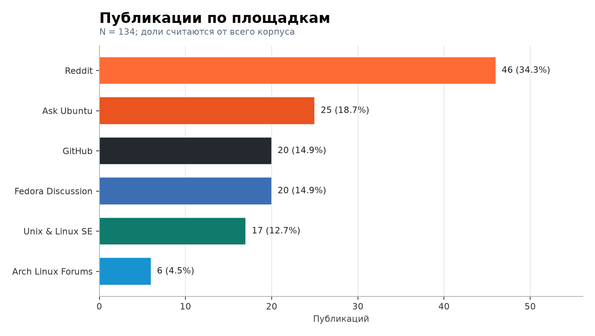

Reddit дал 46 публикаций, почти треть всего материала. Дальше идут Ask Ubuntu (25), GitHub (20), Fedora Discussion (20), Unix & Linux Stack Exchange (17) и Arch Linux Forums (6).

Внутри Reddit основная масса пришла из `r/linuxquestions` (29) и `r/linux4noobs` (15). То есть это в основном вопросы новичков и людей, которые столкнулись с конкретной проблемой, а не теоретические споры.

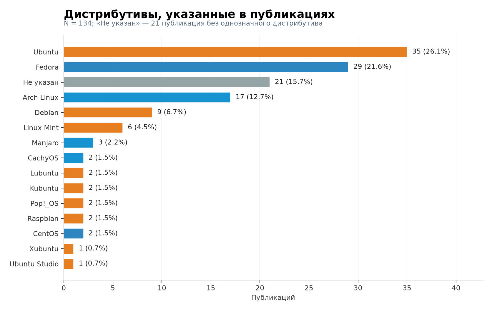

По дистрибутивам ожидаемо лидируют Ubuntu (35) и Fedora (29). Дальше Arch Linux (17), Debian (9), Linux Mint (6). Ещё 21 публикация без явного дистрибутива.

Если собрать родственные дистрибутивы в семьи, получается так:

- Debian и Ubuntu: 60 публикаций;
- Fedora и RHEL: 31;
- Arch и производные: 22;
- дистрибутив не указан: 21.

Для проекта это полезное напоминание: большая часть болей приходит из мира APT и DNF, но Arch тоже заметен, особенно в теме orphan-пакетов (закономерная проблема модели rolling-release)

## 2. Проблемы

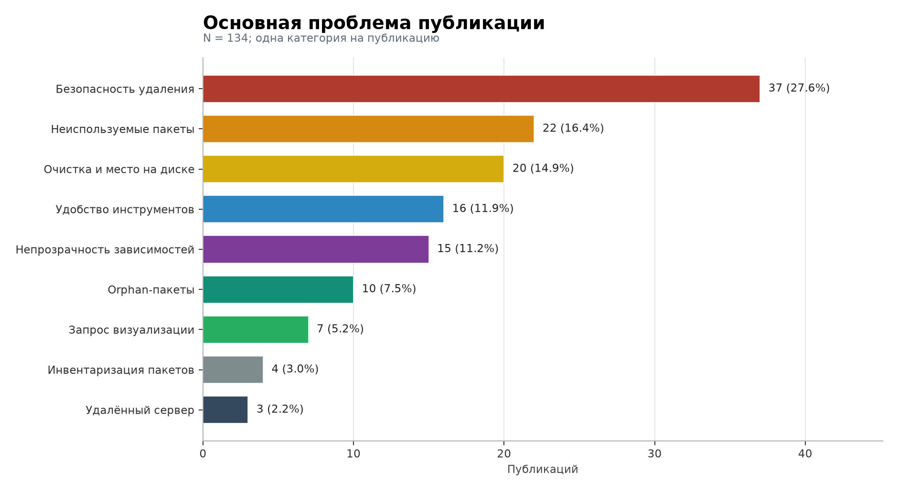

Самая частая категория - безопасность удаления: 37 публикаций (27,6%). Люди боятся выполнить `autoremove` "лишних" пакетов и остаться без загрузки или без рабочего стола.

Дальше идут:

- неиспользуемые пакеты: 22 (16,4%);
- очистка и место на диске: 20 (14,9%);
- удобство инструментов: 16 (11,9%);
- непрозрачность зависимостей: 15 (11,2%);
- orphan-пакеты: 10 (7,5%);
- запрос визуализации: 7 (5,2%);
- инвентаризация: 4 (3,0%);
- удалённый сервер: 3 (2,2%).

Три первые категории дают 79 публикаций, то есть 59% корпуса. Если объяснить одной фразой: людям мешает не отсутствие инструмента удаление, а страх перед тем, что инструмент поведёт себя непредсказуемо (именно поэтому DependenSee не сосредоточен на удалении, а призван помочь самостоятельно проанализировать и удалить пакеты)

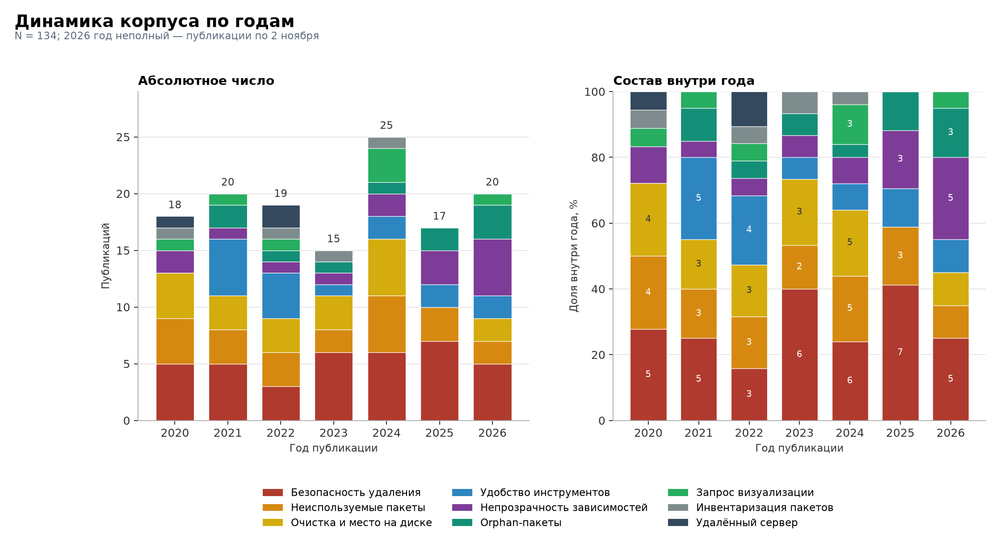

Не смотря на неравномерность, график показывает стабильные всплески интереса к проблеме.

## 3. Анализ популярных проблем

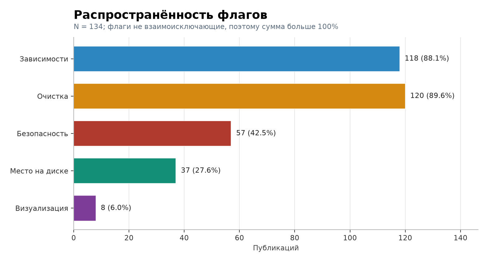

Флаги - это темы, которые встречаются в тексте. Одна публикация может задевать несколько тем.

- Зависимости: 118 из 134 (88,1%).
- Очистка: 120 из 134 (89,6%).
- Безопасность: 57 из 134 (42,5%).
- Место на диске: 37 из 134 (27,6%).
- Визуализация: 8 из 134 (6,0%).

Зависимости и очистка пересекаются у 105 публикаций (78,4%). Это логично. Люди часто хотят удалить что-либо "лишнее", но боятся, что бесполезный на первый взгляд пакет повлечёт за собой каскадное разрушение всей системы.

Безопасность - вторая по важности тема после самих зависимостей и очистки. 20 из 57 публикаций с флагом безопасности находятся вне категории "безопасность удаления". То есть страх сломать систему встречается и в темах про неиспользуемые пакеты, удобство инструментов и непрозрачность зависимостей.

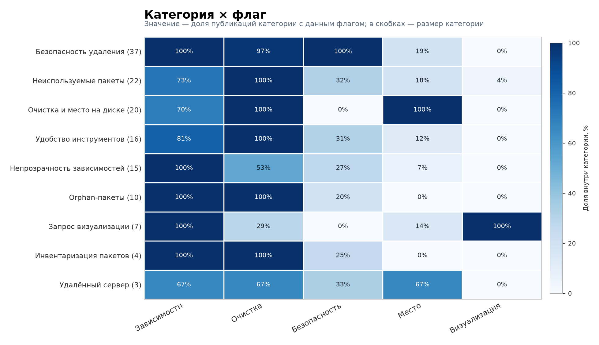

Эта таблица показывает, какие темы встречаются внутри каждой категории.

- В категории "безопасность удаления" 100% публикаций говорят о безопасности, 97% - об очистке, 19% - о месте на диске.
- В категории "очистка и место" 100% говорят о месте на диске и 0% - о безопасности. Тем не менее, я не исключаю, что это ошибка выбора формулировок, ведь людям интересны как минимум "Зависимости"
- В категории "запрос визуализации" 100% говорят о зависимостях и 0% - о безопасности (возможно так же из-за формулировок)
- В категории "orphan-пакеты" 100% говорят о зависимостях и очистке, но только 20% - о безопасности.

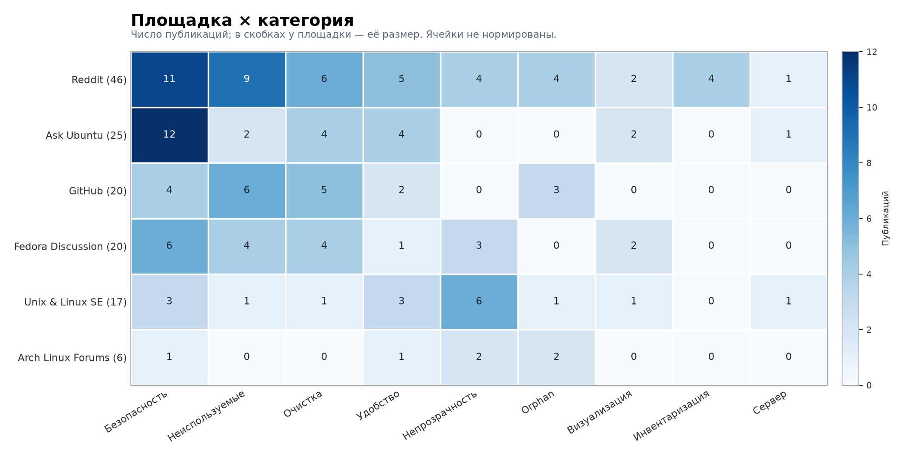

На этой карте видно, о чём чаще говорят на разных площадках.

- Ask Ubuntu заметно чаще про безопасность удаления: 12 из 25 публикаций.
- Unix & Linux Stack Exchange - про непрозрачность зависимостей: 6 из 17.
- Arch-семейство - про orphan-пакеты: 8 из 22.
- GitHub распределён ровнее: неиспользуемые пакеты, очистка, безопасность и orphan идут рядом.

Это состав моей подборки, а не рейтинг площадок. Но для понимания аудитории полезно: новички на Ask Ubuntu больше говорят о страхе удаления. Среди людей более углубленных чаще возникает желание узнать о том, почему и что стоит в их системе.

## 4. Визуализация

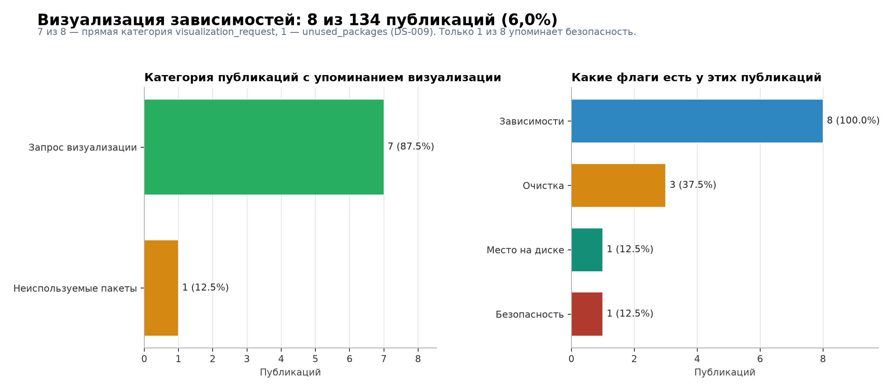

Визуализация - маленькая часть корпуса: 8 публикаций из 134 (6,0%). Семь из них - прямой запрос графа или дерева, ещё одна - DS-009, где визуализация упоминается внутри разговора об очистке.

Что важно: только одна из восьми публикаций вообще упоминает безопасность. Среди семи прямых запросов визуализации таких нет ни одной.

Вот что люди просят:

- DS-007: интерактивное дерево, которое объясняет, почему `dnf5` тянет неожиданные пакеты.
- DS-043: дерево обратных зависимостей вместо плоского списка.
- DS-044: дерево неустановленных зависимостей вместе с размерами файлов.
- DS-082: дерево разрешённых зависимостей APT.
- DS-058: аналог Dependency Walker для Linux, с рекурсивными библиотеками и импортируемыми функциями.
- DS-108: дерево зависимостей для набора пакетов как единого целого.
- DS-124: разбор раздутой установки перед очисткой.
- DS-009: инвентаризация и дерево зависимостей перед очисткой, с упоминанием безопасности.

Главная мысль: визуализация здесь нужна не для красоты и не для кнопки "удалить". Она нужна, чтобы ответить на вопрос "откуда этот пакет взялся и что он держит". Визуализация видится этим людям как самый простой способ объять систему зависимостей взглядом.

## 5. Вовлечённость

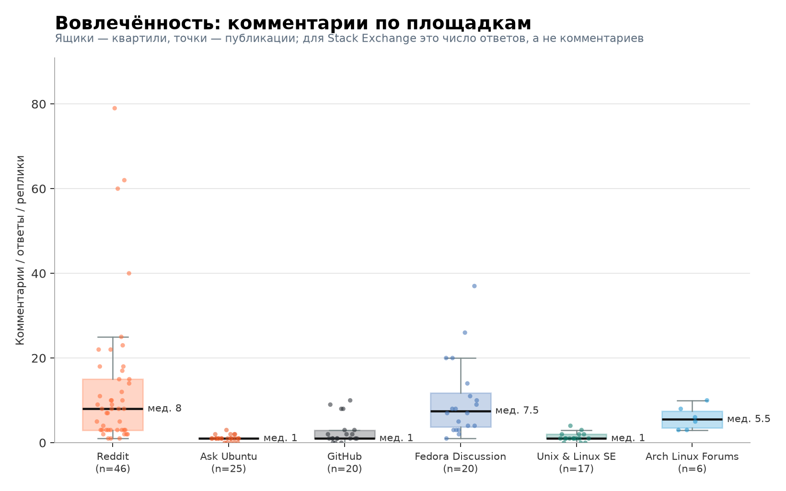

На Reddit типичная публикация собирает 8 комментариев, на Fedora - 7,5, на Arch - 5,5. На GitHub, Ask Ubuntu и Unix & Linux медиана равна 1.

Но сравнивать эти числа напрямую нельзя. На Stack Exchange поле означает число ответов, а не комментариев. На Reddit это комментарии, на Fedora - ответы в теме, на GitHub - комментарии к issue. У площадок разная механика общения.

По рейтингам картина ещё проще: медиана равна 1 на всех трёх площадках, где рейтинг вообще есть. Средние значения вытягивают отдельные выбросы: на Reddit есть пост с 81 баллом, на Unix & Linux - с 22.

Самые обсуждаемые истории:

- 79 комментариев: стратегия против накопления неиспользуемых пакетов;
- 62 комментария: "что это значит?" после `autoremove`;
- 60 комментариев: `autoremove` сломал загрузку;
- 40 комментариев: bash-скрипт для обновления и очистки;
- 37 комментариев: `dnf autoremove` хочет удалить Qt.

## 6. Что уже есть на рынке

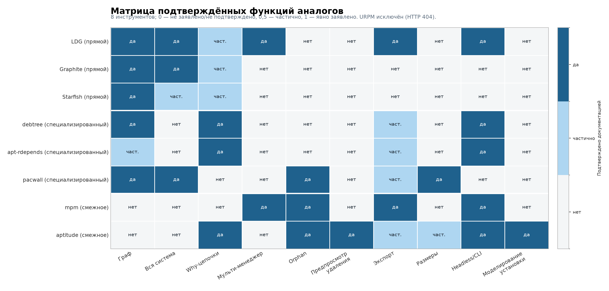

Я сравнил 8 инструментов: LDG, Graphite, Starfish, debtree, apt-rdepends, pacwall, mpm и aptitude. Смотрел документацию и README. 

Коротко по инструментам:

- LDG: мульти-менеджерный аудит, интерактивный HTML-граф, экспорт и сравнение инвентаризаций. Ближе всего к идее "увидеть всю систему".
- Graphite: красивый интерактивный граф установленной APT-системы. Но только APT и без orphan-поиска.
- Starfish: интерактивный граф для Arch, с прямыми и обратными зависимостями.
- debtree: DOT-граф для выбранного Debian-пакета. Мощно, но это CLI и не карта всей системы.
- apt-rdepends: рекурсивные зависимости и обратные зависимости в консоли.
- pacwall: граф-обои всей pacman-системы. Показывает размеры и orphan-пакеты, но это статичная картинка.
- mpm: мульти-менеджерный inventory, снимки, восстановление, список orphan-пакетов и экспорт. Графа зависимостей нет.
- aptitude: why/why-not, автоматически установленные пакеты, предпросмотр действий и моделирование установки. Но только APT и без визуального графа.

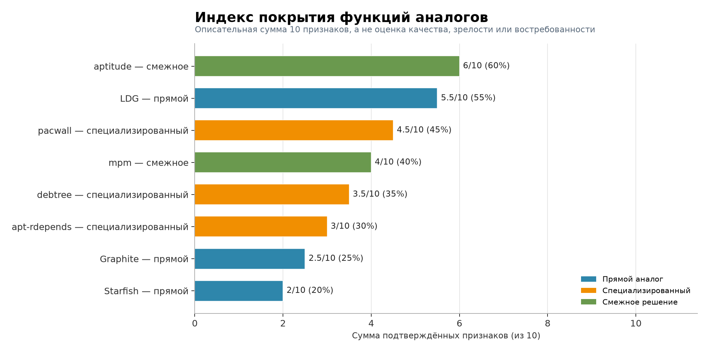

Если просто посчитать, сколько пунктов из моего списка закрывает инструмент, получается такой порядок:

- aptitude: 6 из 10;
- LDG: 5,5 из 10;
- pacwall: 4,5 из 10;
- mpm: 4 из 10;
- debtree: 3,5 из 10;
- apt-rdepends: 3 из 10;
- Graphite: 2,5 из 10;
- Starfish: 2 из 10.

Самое интересное начинается, если смотреть не на отдельные галочки, а на комбинации:

- граф и мульти-менеджерность есть только у LDG;
- граф и orphan-поиск есть только у pacwall, но только для pacman и без интерактива;
- мульти-менеджерность и orphan-поиск есть только у mpm, но без графа;
- orphan-поиск и предпросмотр удаления есть только у aptitude, но без графа;
- графа и предпросмотра удаления нет ни у кого одновременно;
- графа и моделирования установки тоже нет ни у кого одновременно.

Это говорит о наличии аналогов в каждом из сценариев, но не во всех сразу

Один старый кандидат, URPM, сейчас недоступен (репозиторий отдаёт 404), а потому он отсутствует в некоторых сравнениях.

## 7. Где может быть место DependenSee

DependenSee может казаться ещё одним проектом, решающим уже давно решённую задачу. Но на самом деле - отнюдь. Да, у проекта много конкурентов. Но "Нет ничего нового под солнцем". Но ни у одного из проектов не было возможности удалённого просмотра графа с удалённого сервера без предварительной загрузки файла, прямо в режиме реального времени. DependenSee не будет единственным. Зато он сможет собрать опыт конкурентов и добавить что-то от себя. Возможно, став лучшим решением для определённых задач.
## Итог

Корпус показывает три вещи.

Первое: основная проблема не в том, что пакетов много, а в том, что непонятно, какие из них нужны и что будет после удаления.
Второе: визуализация сама по себе интересна немногим, но запросы на неё очень точные. Люди хотят наглядности в управлении титаническими объёмами пакетов на linux-машинах.
Третье: аналоги закрывают отдельные куски задачи, но не весь спектр, а значит есть место для своей ниши.